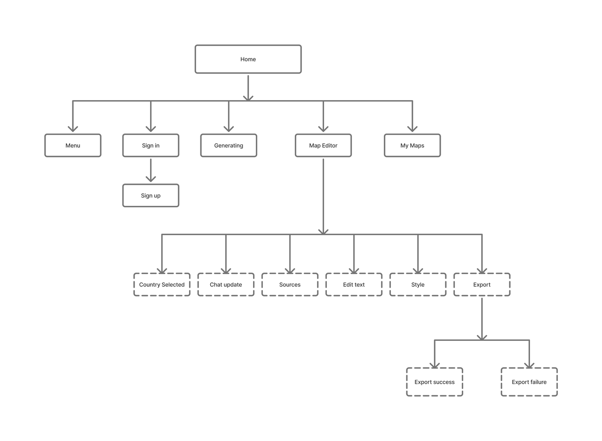
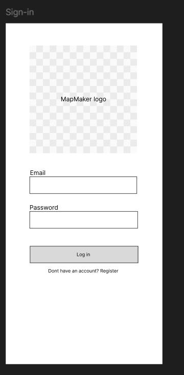
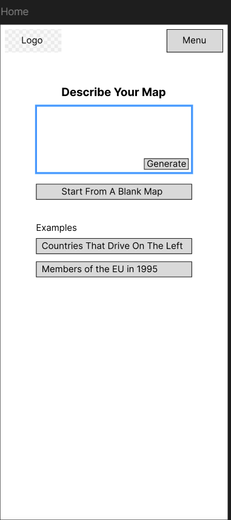
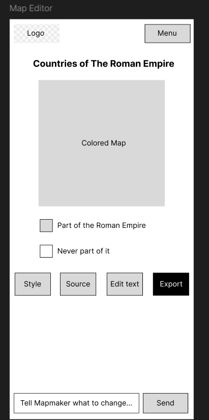
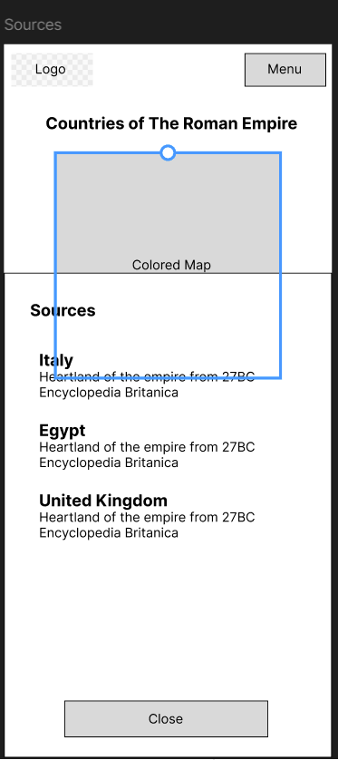
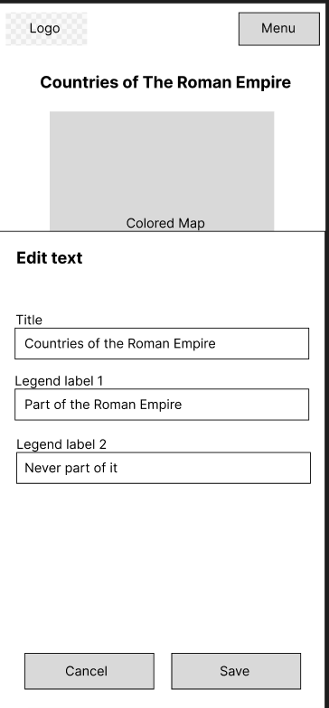
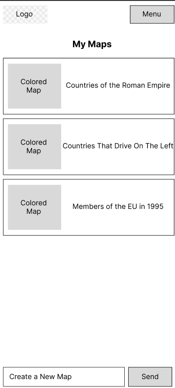

# User Experience Design

This repository contains instructions and files for two assignments that together comprise the user experience design phase of a web app.

Replace the contents of this file with the completed assignments, as described in:

- [app map & wireframe instructions](instructions-0a-app-map-wireframes.md).
- [prototype instructions](instructions-0b-prototyping.md)

## App_Map/SiteMap

## Wireframes:

### Sign in:
.

Login in page for user.
### Home Page:

Home page for MapMaker. As seen by App_Map,This is the root layer of Mapmaker app

### Map Editor:

Page that shows how users can edit their maps. Users can choose the style, see what sources were used to construct their map,click to edit the map text, and finally export their map.

In addition, users can also prompt MapMaker using the chat function below

### Sources:

Shows user the sources used to construct the map

### Edit Text:

Page where users can edit text. 

### My Maps:

The page that contains all  of the user's maps along with picture of those maps

